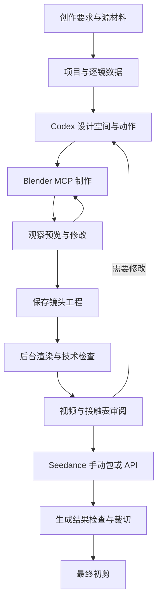

# AI Video Workflows

**让本地 Codex 接通 Blender，执行分镜整理、白模预演、镜头修改、批量渲染，并把可检查的素材交给 Seedance。**

这是可执行工具、仓库规则和可复用 skill 的组合。适用于叙事短片、产品演示、空间漫游、动作调度等项目；每部作品有独立数据和资产。核心代码不包含特定故事、人物或固定分镜编号。

[开始连接](docs/SETUP.md) · [完整流程](docs/WORKFLOW.md) · [项目与分镜](docs/PROJECTS.md) · [Blender 制作](docs/BLENDER.md) · [Seedance](docs/SEEDANCE.md) · [最终初剪](docs/FINISHING.md) · [验证记录](docs/VERIFICATION.md)

## 给 Codex 的启动指令

在安装 Blender 的电脑上，让本地 Codex 打开或克隆本仓库，发送：

```text
请接手 https://github.com/venividici/AI-video-workflows。
读取 AGENTS.md 和 video-workflow skill，直接把本机环境检查和 Blender MCP 连接搭好。
优先复用已有安装；需要时按仓库的官方来源安装依赖，不修改我的模型与其他项目配置。
先跑通一个通用示例，实际检查场景、关键帧和预演视频，交付工程、MP4、接触表与检查结果。
我希望你执行建模、动画、渲染和修正，我负责看效果、提导演意见。
如当前会话必须重开才能加载 MCP，先完成其他准备并告诉我准确的恢复步骤。
这一步先完成本地预演和离线生成交接包，不发起付费视频生成。
```

已有自己的作品时补一句“项目素材在……，严格按原分镜制作”。Codex 应读取材料后建立独立项目；不用将作品内容写进通用引擎。

## 能执行什么

| 环节 | 仓库提供的能力 |
|---|---|
| 环境接入 | 程序发现、版本检查、项目级 MCP 配置、固定 addon 安装、Blender GUI 启动 |
| 连通核验 | addon socket、真实 MCP STDIO、创建/动画/渲染/清理 smoke；当前会话再实际调用工具 |
| 分镜整理 | CSV / TSV / JSON / XLSX 导入；列映射、原始行、重复编号、短镜时长、来源哈希与问题报告 |
| 白模制作 | 共享对象/材质/场景、逐镜机位与关键帧；MCP 中可继续编辑 |
| 复杂工程 | `adopt-blend` 接入现有模型、骨骼、模拟或复杂 `.blend`，保留工程版本与验证凭据 |
| 批量渲染 | 每镜 `.blend`、可恢复 PNG 序列、精确帧数 MP4；拒绝过期输入与混用旧帧 |
| 审阅 | 首/中/尾接触表、串联预演、离线 HTML 镜头页、绑定视频版本的检查记录 |
| 视频生成 | Seedance 离线手动包，及显式授权后的 API 提交/查询/下载；任务回执防重复提交 |
| 回到剪辑 | 原片保留、按镜头精确裁切、帧率/尺寸统一、最终直切初剪 |

**创作仍由 Codex 结合材料完成。** 导入器不会从任意剧本自动推导出合格的场景、表演或镜头；它提供可靠的数据与执行通道。Codex 要实际查看预演、修正问题，再进入下一阶段。

## 工作关系



MCP 是交互入口，`bpy` 承担精确操作，独立 Blender 进程承担长渲染。三者配合使用。Seedance 接收的是视频/图片参考等受支持输入，不直接读取 `.blend`；生成结果仍需要检查构图、身份、运动和接触关系。

## 最小可运行示例

要求 Python 3.11+、Blender、FFmpeg。完整本机接入还需要 uv/uvx。下面命令通常由 Codex 执行；当前版本以完整源码仓库交付，从根目录运行。请保留 templates、scripts、providers 等运行资源；尚未提供自包含的 wheel 安装包。

```bash
python -m aivw doctor
python -m aivw setup-mcp --apply --install-addon
python -m aivw launch-blender
python -m aivw mcp-probe --stdio
python -m aivw mcp-smoke --stdio --output .runtime/smoke-001.png
```

新 MCP 配置需要重开 Codex 会话时，先按 [SETUP](docs/SETUP.md) 完成一次重开与实际工具调用。

随后生成通用产品预演：

```bash
python -m aivw init projects/my-demo --example product-orbit
python -m aivw validate --project projects/my-demo
python -m aivw build --project projects/my-demo --engine CYCLES --resolution 640x360 --samples 8
python -m aivw render --project projects/my-demo
python -m aivw assemble --project projects/my-demo
python -m aivw contact-sheet --project projects/my-demo
python -m aivw review-board --project projects/my-demo
python -m aivw seedance prepare --project projects/my-demo
```

Blender 不在 PATH 时，在 build/render/adopt 命令使用 `--blender` 或设置 `BLENDER_BIN`。快速白模可选择 Workbench；Linux 图形驱动与后台模式细节见 [Blender 指南](docs/BLENDER.md)。

输出位于项目内：`build/` 存工程与凭据，`renders/` 存逐镜 PNG/MP4，`outputs/` 存预演、接触表、审阅页、Seedance 包和最终初剪。中断后运行 `status`，再重跑需要的步骤；有效帧会按哈希复用。

## 用自己的材料

```bash
python -m aivw init projects/my-film --title "我的作品"
python -m aivw inspect-input "/path/to/storyboard.xlsx"
python -m aivw import-shots --project projects/my-film --input "/path/to/storyboard.xlsx" --sheet "逐镜细化" --header-row 1 --mapping templates/columns-zh.json
```

这些命令保留分镜并报告歧义。接下来由 Codex 按原始材料设计 `scene.json` 或通过 MCP 制作并登记复杂工程。存在多个工作表、模糊列名、缺时长或公式无缓存时，会给出具体问题，不会默默猜测。详细字段与恢复方式见 [PROJECTS](docs/PROJECTS.md)。

## 内置示例与边界

- `examples/product-orbit`：产品与台座、相机移动，验证共享资产与机位。
- `examples/dialogue-blocking`：两个角色替身与切换机位，验证人物调度和镜头连续性。
- `templates/storyboard-example.csv`：配送车题材，验证导入与来源追踪。

示例仅使用基础几何体，目标是证明流程可运行。真实角色建模、复杂接触、表演、物理模拟、调色、字幕、音乐和声音设计由 Codex 按项目继续制作；不将示例质量冒称为最终电影质量。

Seedance 的账号开通、模型权限、素材授权和费用属于使用方的实际环境。无 API 时手动包可直接用于平台操作；API 适配目前覆盖文档核验过的 2.5 reference/edit 模式。其他供应商、首尾帧、视频延长等应新增适配器，不能直接照搬字段。

## 目录与维护

| 目录/文件 | 用途 |
|---|---|
| `AGENTS.md` | Codex 每次接手时的执行规则 |
| `.agents/skills/video-workflow/` | 可按任务调用的仓库技能 |
| `aivw/` | 无额外 Python 依赖的命令行工具 |
| `blender_scripts/`、`scripts/` | Blender 内执行的构建、渲染与接入代码 |
| `schemas/`、`templates/` | 通用项目规范与导入映射 |
| `examples/` | 自拟公开样例 |
| `docs/` | 连接、制作、生成、剪辑与实测记录 |
| `projects/`、`.runtime/` | 本地项目与安装/日志，默认 Git 忽略 |

检查命令：`python -m unittest discover -s tests -v`。同时设置 `AIVW_RUN_BLENDER_TESTS=1` 和 `BLENDER_BIN` 后会增加真实 Blender 集成检查；本地网络测试只使用回环服务和假 Key。具体运行证据和未验证范围见 [VERIFICATION](docs/VERIFICATION.md)。

上游来源、版本基线与官方文档见 [SOURCES](docs/SOURCES.md)。Blender MCP 是社区项目；本仓库使用其固定版本，不把它表述为 Blender Foundation 官方产品。
