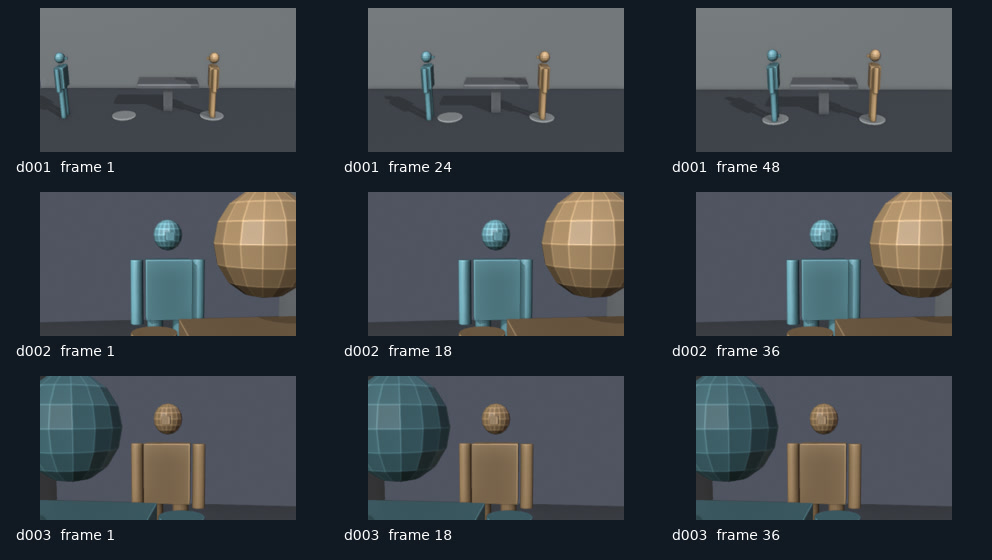

# 双人走位与反打示例

原创的两人工作交接场景，三个镜头共 120 帧，24 fps，准确片长 5 秒。人物用 1.75 米的简化人偶表示。第一镜验证位置动画，后两镜验证同侧反打与一致场景资产。人偶是走位代理，**没有逼真步态、口型或表演**；对白仅留在镜头数据中，不会被伪称为已完成配音。

## 已实际渲染的小样

[观看预演 MP4](preview/previs.mp4) · [验证记录](preview/verification.json)



此小样由 Blender 4.5.3 LTS 的 Workbench 在软件 OpenGL 下实际渲染，草稿尺寸为 320×180。FFprobe 已解码核对 120 帧、24 fps、5 秒。接触表已检查走位起止、前景人物和两侧反打构图；这不等于通过了真实人物表演。`verification.json` 保留输入、工作流代码和交付文件的 SHA256。

## 从源场景重建

```bash
python -m aivw build --project examples/dialogue-blocking --blender /path/to/blender
python -m aivw render --project examples/dialogue-blocking --blender /path/to/blender
python -m aivw assemble --project examples/dialogue-blocking
python -m aivw contact-sheet --project examples/dialogue-blocking
```

在 `scene.json` 修改 `a`、`b` 的初始位置与镜头配置后重新构建。第一镜位置动画会覆盖 `a` 的初始位置；要改变实际走位，请修改 `d001.animation`。后续镜头从最后站位开始。

若服务器缺少 Workbench 所需的图形上下文，明确使用 `build ... --engine CYCLES --samples 8`；这会使用 CPU 渲染。低分辨率小样可加 `--resolution 320x180`，不会改变帧数或帧率。
