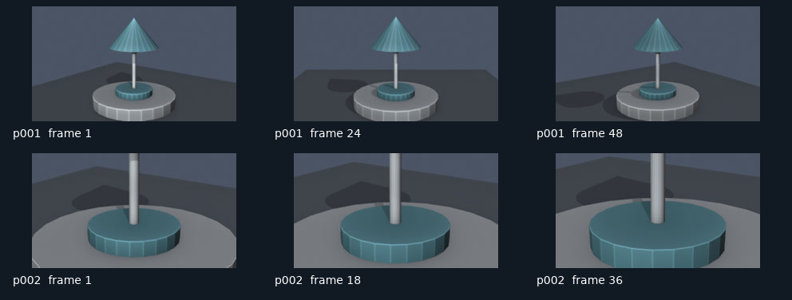

# 产品运镜示例

原创的简化桌面灯，两个镜头共 84 帧，24 fps，准确片长 3.5 秒。用于演示同一资产的环绕机位与局部推近。它不是用户故事资产，也不代表写实成片质量。

## 已实际渲染的小样

[观看预演 MP4](preview/previs.mp4) · [验证记录](preview/verification.json)



此小样由 Blender 4.5.3 LTS 的 Workbench 在软件 OpenGL 下实际渲染，草稿尺寸为 320×180。FFprobe 已解码核对 84 帧、24 fps、3.5 秒；接触表已检查构图。`verification.json` 保留输入、工作流代码和交付文件的 SHA256。

## 从源场景重建

从仓库根目录运行：

```bash
python -m aivw build --project examples/product-orbit --blender /path/to/blender
python -m aivw render --project examples/product-orbit --blender /path/to/blender
python -m aivw assemble --project examples/product-orbit
python -m aivw contact-sheet --project examples/product-orbit
```

无图形上下文的服务器可显式用 `build ... --engine CYCLES --samples 8` 构建 CPU 渲染版本。测试用低分辨率须明确添加 `--resolution 320x180`，会记录在产物回执中。查看 `outputs/previs.mp4` 与 `outputs/contact-sheet.jpg`。
